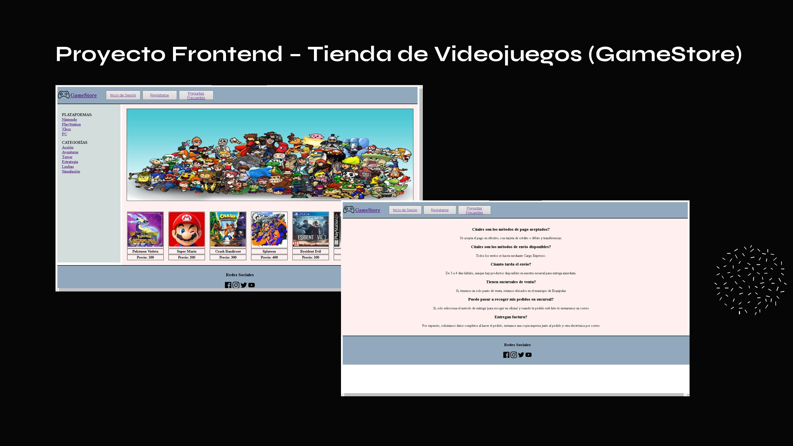
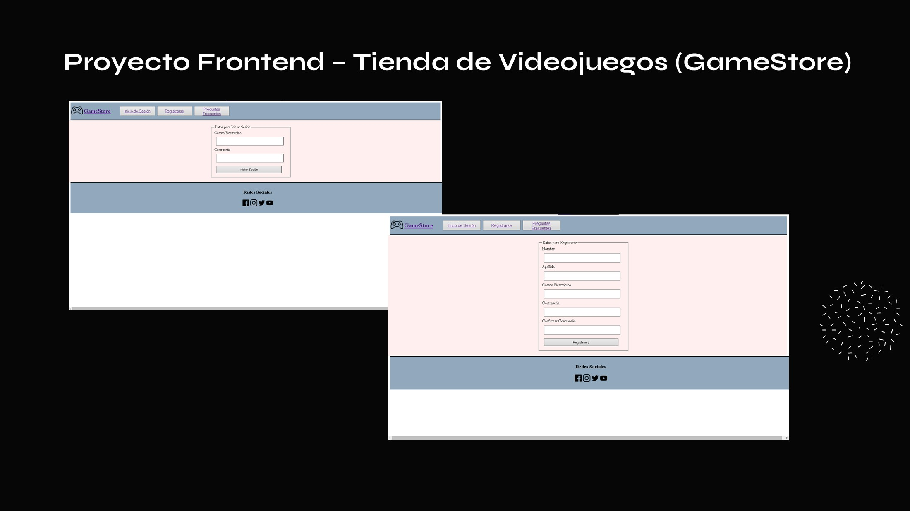

# GameStore — Frontend Estático

Sitio web estático de una tienda de videojuegos (**GameStore**), desarrollado con **HTML5** y **CSS3**, que incluye catálogo principal, preguntas frecuentes y formularios estáticos de acceso y registro.

## Vista previa

| Catálogo principal y Preguntas Frecuentes | Inicio de Sesión y Registro |
| :---: | :---: |
|  |  |

## Características principales

- **Catálogo principal:** Barra lateral de plataformas (*Nintendo*, *PlayStation*, *Xbox*, *PC*) y categorías (*Acción*, *Aventuras*, *Terror*, *Estrategia*, *Luchas*, *Simulación*), imagen de portada y tabla de títulos destacados con precios.
- **Preguntas frecuentes (FAQ):** Sección informativa sobre métodos de pago, envíos, tiempos de entrega, sucursal y facturación.
- **Acceso y registro:** Vistas dedicadas con formularios estáticos de inicio de sesión y registro de usuario.
- **Navegación y pie de página:** Encabezado común entre vistas y bloque de redes sociales.

## Tecnologías utilizadas

- **HTML5** (estructura semántica multipágina)
- **CSS3** (maquetación con *floats*, Flexbox, tablas y formularios)

## Contexto y estado del proyecto

- **Contexto:** Práctica de desarrollo web frontend estático con fines académicos.
- **Estado:** Finalizado (maquetación estática archivada para portafolio).

## Autor

**Daniel Alejandro Arita Leiva**
